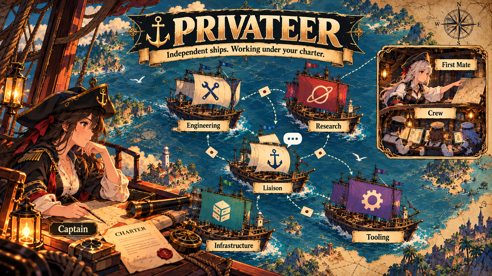

<h1 align="center">Privateer</h1>

<h3 align="center">Independent ships. Working under your charter.</h3>

<p align="center">
  
</p>

Privateer is a fresh Rust runtime for independent peer agents working under a charter. One conversational agent is your familiar point of contact; departments can coordinate directly and keep working while that conversation is busy. Every outcome has a recorded owner.

The first milestone is durable machinery and an isolated working pilot. It does not install over an existing fleet, create production credentials, or run model inference automatically.

See [milestone status and validation](docs/milestone-1.md) for what is implemented, demonstrated, and still needed before fleet replacement. The agreed direction for conversation and activation (the captain, ships and their first mates, mailboxes, channels and standing grants) is in [the conversation and activation design](docs/design/conversation-and-activation.md).

## Terminal dashboard

The optional Rust dashboard opens on a Fleet overview with ships in a persistent
sidebar. Each ship has its own Bridge, Assignments, Terminals and Logbook views:

```sh
cargo run --features dashboard --bin privateer-dashboard -- --demo
```

The dashboard reads your local fleet, aggregates the captain's real inbox, and
can board a ship in Herdr, create or retire ships, and manage dispatchers. An
empty fleet offers a liaison or another first ship in a dedicated folder.
All changes go through Privateer commands. Demo mode stays sample-only.
Click a ship, then its workspace tabs; `0` returns home, `i` opens the inbox,
`m` messages, and `b` boards. Herdr uses only the injected or explicitly selected
socket, with exact pane bindings. Injection of mail into agent panes is proposed
but remains disabled pending a safe server-side occupant guard.
See [dashboard setup and boundaries](docs/dashboard.md).


## Quick start

Bare `privateer` opens an installed fleet dashboard in ordinary terminals and
Herdr. With no current ship, first-run setup offers a dedicated ship folder.

```sh
cargo install --locked --path . --features dashboard  # installs privateer + privateer-dashboard
privateer                           # fleet dashboard and first-run setup
cd ~/ships/liaison                   # after creating this ship in setup
privateer start                     # talk to this ship's first mate directly
```

The dashboard uses an executable installed beside the runtime or on PATH.
If it is missing, bare `privateer` keeps the legacy flow: in a ship folder it
ensures the dispatcher and opens the harness; elsewhere it offers to initialize
the current folder first (`--yes` skips that question). Without a configured
Herdr socket, dashboard observation, inbox and setup remain available; creation
shows a quoted `privateer --home HOME start` command for direct access.

The background dispatcher answers mail while you are away; it is installed as a systemd user service where available, otherwise run in the background for this login (`privateer service status|start|stop`). Other everyday commands, from anywhere in the ship folder: `privateer ask infra "..."`, `privateer inbox`, `privateer status`, `privateer project add <git url>`. Add more ships without leaving the one you are in: `privateer ship new apps --scope "Application work"` (or ask your first mate to); ships on one machine find and mail each other automatically, and `privateer ship retire NAME` retires one. In the legacy flow, scripts can use `privateer --yes` to skip the initialization question.

For installation updates and recovery, see [replacing the installed executable](docs/architecture.md#replacing-the-installed-executable).

## General runtime and optional integrations

The core owns charters, tasks, custody, targeted messages, coalesced notifications, durable jobs, resource admission, and SSH transport. It contains no personal provider account, model, gateway address, machine name, or user path.

Harnesses and provider routes are optional executable plugins. A private gateway belongs in a plugin's private configuration. Core jobs receive approved argv through the plugin interface; they do not invent a fallback provider. See [architecture](docs/architecture.md) and [plugin examples](plugins/).

The default charter allows implementation, testing, opening PRs, merging passing work, routine recovery, cleanup, delegation, and messaging. Production requires approval of the exact artifact and environment. The current delivery check records workflow evidence; forge merge and production deployment adapters are future integrations.

For human-authored command arguments, use a YAML or JSON file:

```sh
privateer --home /absolute/private/home charter.put --file examples/charter.yaml
```

Edit the [example charter](examples/charter.yaml) for your repository first.
`--file` accepts regular UTF-8 `.yaml`, `.yml` and `.json` files, containing one
object with unique string keys and JSON-compatible values. Plain YAML integers
must fit `i64` or `u64`; floating-point numbers must fit finite `f64` values.
Quote numeric-looking text or use `!!str` to keep it as a string, including in
mapping keys. For `--file`, raw input and normalized JSON arguments are each
limited to 64 KiB, with at most 64 nesting levels, 10,000 nodes (including keys),
and 1 MiB of expanded scalar/key data. Nonrecursive YAML aliases are supported
within these budgets. Parsing finishes before a home is opened.
YAML supplies data: it does not read includes, run constructors or expand
environment variables. Local custom tags are rejected; standard core tags and
inert global annotations may be accepted or ignored as ordinary data. Existing
command validation still applies. Use `--file` once, separately from `--json`;
it supplies command arguments, not runtime configuration. RPC, hooks and internal
supervisors do not accept `--file`. Inline `--json` and all machine protocols and
outputs continue to use JSON. To pass `--file` to a native harness, put it after
the separator in `privateer start HARNESS -- --file PATH`.

## Build and try the isolated pilot

Rust 1.85 or newer and Cargo are required. Unix systems are supported for process-group supervision. Python 3 is used by optional native adapters and process fixtures; Git is used by the pilot. Node 24 is required for the Pi/OMP extension tests. The extension runs inside the chosen harness in normal use.

```sh
cargo build
cargo test
python3 scripts/pilot.py --binary target/debug/privateer
```

The pilot creates temporary homes for a navigator and two departments, a small Git repository, and a shared resource ledger. It demonstrates direct peer messages, repeated-alert aggregation, detached work surviving its launcher, resource admission, and durable completion. It performs no live inference, remote publishing, or fleet update. Its evidence and temporary files are retained at the reported path for inspection.

For an independent CLI home:

```sh
privateer --home /absolute/private/home init --json '{}'
privateer --home /absolute/private/home status --json '{}'
```

Register an SSH peer after installing the same binary on that host:

```sh
privateer --home /absolute/private/home peer.put --json '{"name":"infrastructure","host":"department-host","executable":"/absolute/bin/privateer","home":"/absolute/privateer/home"}'
privateer --home /absolute/private/home peer.call --json '{"name":"infrastructure","command":"status","args":{}}'
```

Native SSH handles authentication and host verification. The remote executable and home must be absolute paths; an SSH host is an alias or `user@host`. The caller receives the remote JSON envelope, including its correlation ID and success/error result. Remote state remains remote. The current peer address is a transport configuration, not a proof that another host inherited a charter.

## Safety and reliability boundaries

SQLite transactions preserve local state and custody. Job supervisors own process groups, bound logs and deadlines, and use a host-wide capacity ledger. A busy navigator is not a lock on department work. Notification acknowledgments cover only the observed sequence, so newer facts remain pending.

Charters govern this workflow under the operating-system account running Privateer. They are not an adversarial credential sandbox. Agents launched by Privateer run with an agent role that refuses operator commands (charter changes, approvals, peer and resource configuration) and binds actor names to their own identity; this guards against confused agents, not deliberate evasion. Model reasoning still comes from the chosen harness; this milestone has not established a fully autonomous multi-harness fleet. Read [pilot scope](docs/pilot.md) before comparing its evidence with a production deployment.

Privateer is inspired by First Mate's orchestration and Corsair's experiments, but starts with a new codebase rather than inheriting their shell runtime.
